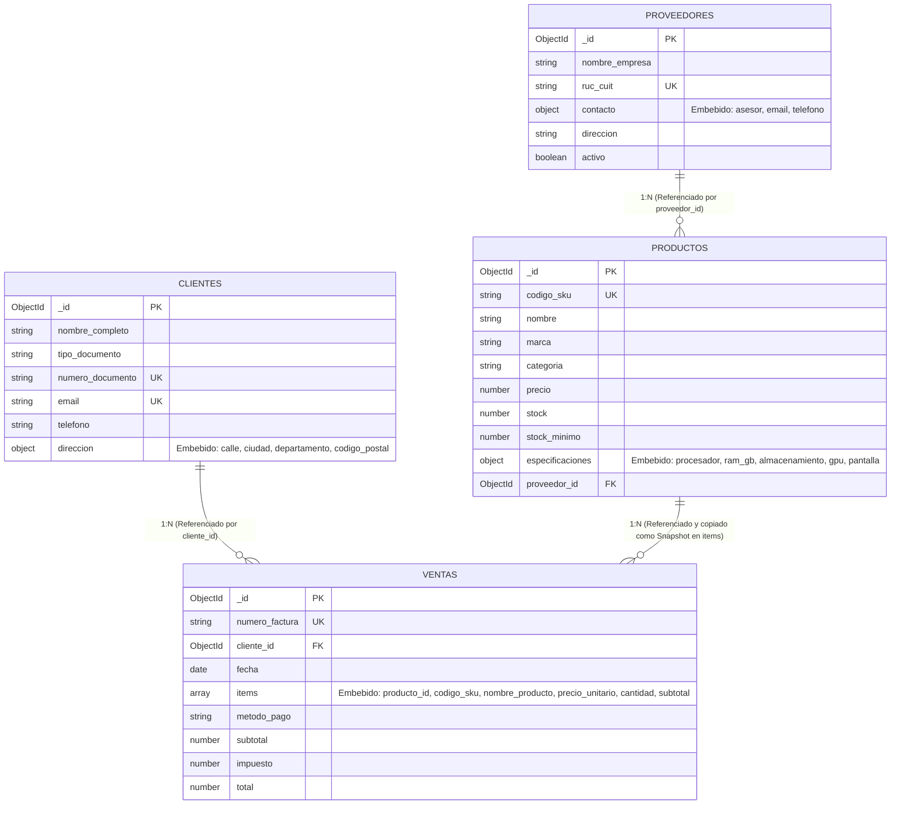

# Modelado e Infraestructura de Base de Datos NoSQL (MongoDB)
**Proyecto:** Sistema de Venta de Computadoras y Hardware  
**Autor:** Rodrigo Gutierrez Lazo  
**Fecha:** 28/10/2026  

---

## 1. Diagrama del Modelo de Documentos

El siguiente diagrama ilustra la arquitectura de datos implementada, detallando las colecciones, subdocumentos embebidos y referencias relacionales mediante `ObjectId`:



---

## 2. Justificación Técnica: Embeber vs. Referenciar

En MongoDB, la arquitectura de modelado debe equilibrar rendimiento en lectura/escritura, tamaño del documento y consistencia de los datos.

### 2.1 Especificaciones Técnicas en `productos` (Documento Embebido)
* **Decisión:** Embeber las especificaciones (`procesador`, `ram_gb`, `almacenamiento`, `tarjeta_grafica`, etc.) dentro de cada documento en la colección `productos`.
* **Justificación:**
  1. **Relación 1 a 1 de Alta Cohesión:** Un conjunto de especificaciones técnicas pertenece de manera exclusiva a un equipo de cómputo específico. No tiene existencia ni relevancia fuera del producto.
  2. **Optimización de Lecturas (Evita Joins):** En una tienda de computadoras, la consulta más frecuente es la ficha técnica del equipo. Al estar embebida, la base de datos recupera toda la información en una sola operación de E/S de disco (`single-document read`).
  3. **Esquema Flexible (Polimorfismo BSON):** Permite almacenar atributos que aplican a laptops (como `pantalla_pulgadas`), omitiéndolos o cambiándolos fácilmente cuando se trata de componentes o periféricos, sin requerir migraciones complejas de esquemas.

### 2.2 Proveedores en `productos` (Referencia por `ObjectId`)
* **Decisión:** Almacenar `proveedor_id` como referencia (`ObjectId`) apuntando a la colección independiente `proveedores`.
* **Justificación:**
  1. **Relación 1 a Muchos con Reutilización:** Un solo distribuidor (ej. Tech Wholesale Corp) provee cientos de productos distintos.
  2. **Consistencia de Datos:** Si un proveedor actualiza su número de contacto o dirección fiscal, solo se modifica un único documento en `proveedores`. Si se hubiese embebido el proveedor dentro de cada producto, se generarían miles de actualizaciones concurrentes y alto riesgo de inconsistencia.

### 2.3 Items de Compra en `ventas` (Patrón Snapshot Embebido)
* **Decisión:** Almacenar un arreglo de subdocumentos en `ventas.items` que incluye tanto el `producto_id` de referencia como los datos inmutables al momento de la venta (`nombre_producto`, `codigo_sku`, `precio_unitario`).
* **Justificación:**
  1. **Inmutabilidad Fiscal y Contable (Patrón Snapshot):** El hardware informático fluctúa constantemente de precio debido al mercado y a promociones. Si un cliente compró una laptop en $5,499.00 y el precio en el catálogo sube a $5,999.00 al mes siguiente, la factura histórica debe permanecer inalterada.
  2. **Integridad ante Eliminaciones:** Si un producto antiguo es retirado o eliminado del catálogo, los registros contables históricos de ventas siguen conservando la descripción y el monto exacto facturado.

### 2.4 Clientes y Ventas (Referencia por `ObjectId`)
* **Decisión:** La venta referencia al cliente mediante `cliente_id`, y no se embebe el historial de compras dentro del documento del cliente.
* **Justificación:**
  1. **Prevención del Antipadrón *Unbounded Growth*:** Un cliente frecuente o corporativo puede acumular cientos o miles de órdenes de compra con el paso del tiempo. Si las ventas se incrustaran en el cliente, el arreglo crecería indefinidamente, arriesgando el límite físico estricto de **16 MB por documento BSON** de MongoDB y degradando el rendimiento en memoria de las lecturas del perfil del cliente.

---

## 3. Estrategia de Índices y Optimización

Para garantizar que el motor de consultas de WiredTiger realice index scans (`IXSCAN`) en lugar de escaneos completos de colección (`COLLSCAN`), se definieron los siguientes índices:

1. **`productos`:**
   * `{ codigo_sku: 1 }` (Único): Búsqueda instantánea por código de inventario.
   * `{ categoria: 1, precio: 1 }` (Compuesto): Optimiza el filtrado habitual de clientes que exploran una categoría (ej. Laptops) ordenando o filtrando por rango de presupuesto.
   * `{ nombre: "text", marca: "text", "especificaciones.procesador": "text" }` (Índice de Texto): Permite búsquedas textuales de palabras clave desde la barra de búsqueda de la tienda.

2. **`clientes`:**
   * `{ email: 1 }` (Único): Verificación de usuario y autenticación sin colisiones.
   * `{ numero_documento: 1 }` (Único): Registro fiscal único (DNI/RUC).

3. **`ventas`:**
   * `{ numero_factura: 1 }` (Único): Búsqueda rápida de comprobantes de pago.
   * `{ fecha: -1 }`: Optimización de reportes cronológicos y listados de transacciones recientes.
   * `{ cliente_id: 1 }`: Acelera la búsqueda del historial de compras de cualquier usuario.

---

## 4. Validador JSON Schema (MongoDB Native BSON)

En entornos de producción o al crear la colección directamente en `mongosh`, se puede emplear el validador JSON Schema nativo:

```javascript
db.createCollection("productos", {
  validator: {
    $jsonSchema: {
      bsonType: "object",
      required: ["codigo_sku", "nombre", "marca", "categoria", "precio", "stock", "especificaciones", "proveedor_id"],
      properties: {
        codigo_sku: {
          bsonType: "string",
          description: "Debe ser una cadena única y requerida"
        },
        nombre: {
          bsonType: "string",
          description: "Nombre comercial del equipo o componente"
        },
        categoria: {
          enum: ["Laptops", "Desktops", "Monitores", "Componentes", "Perifericos"],
          description: "Categoría dentro de los valores permitidos"
        },
        precio: {
          bsonType: "double",
          minimum: 0,
          description: "Precio de venta mayor o igual a 0"
        },
        stock: {
          bsonType: "int",
          minimum: 0,
          description: "Cantidad disponible en almacén"
        },
        especificaciones: {
          bsonType: "object",
          required: ["procesador", "ram_gb", "almacenamiento"],
          properties: {
            procesador: { bsonType: "string" },
            ram_gb: { bsonType: "int", minimum: 0 },
            almacenamiento: { bsonType: "string" }
          }
        },
        proveedor_id: {
          bsonType: "objectId",
          description: "Referencia válida hacia la colección proveedores"
        }
      }
    }
  }
});
```
